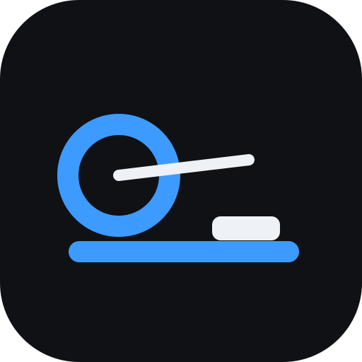
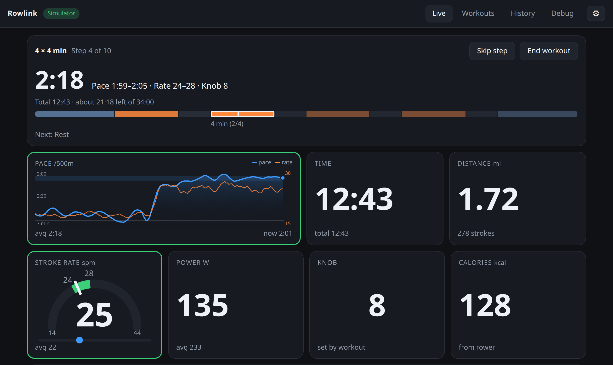
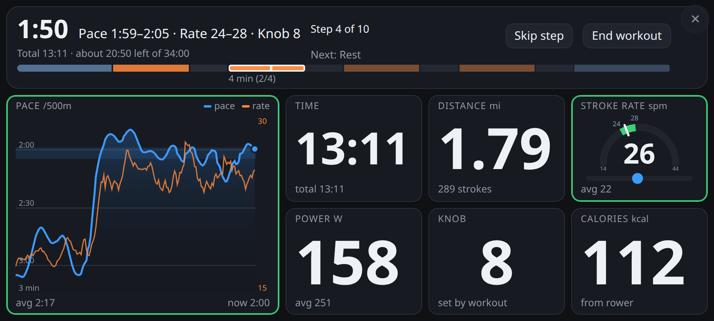
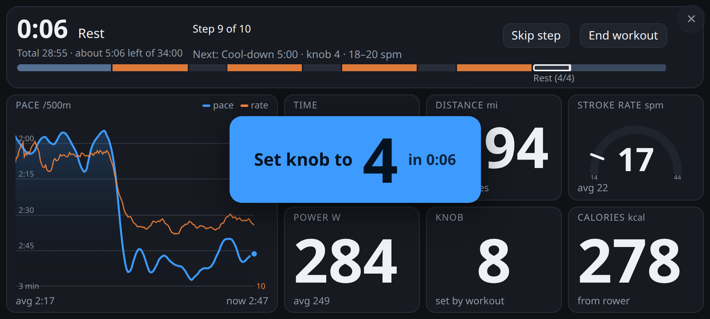
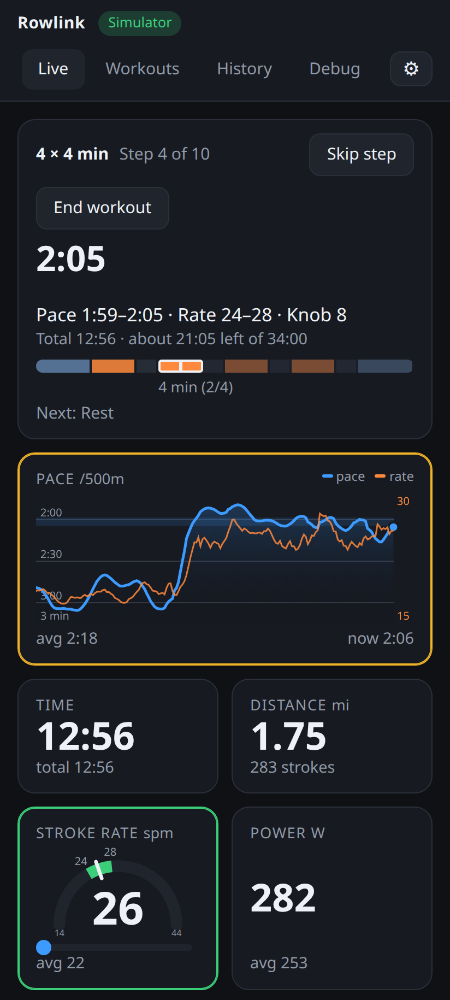
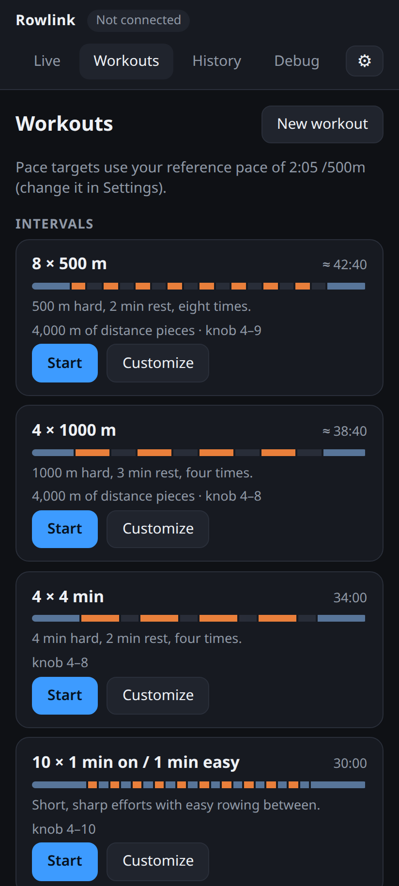
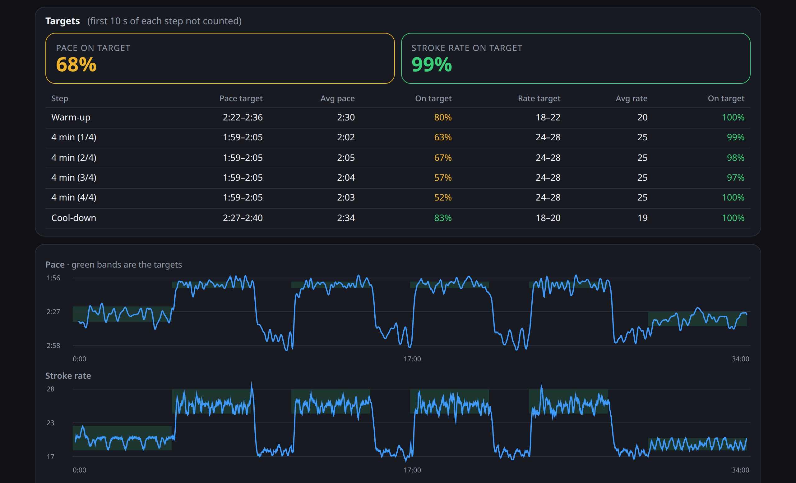

<p align="center">
  
</p>

<h1 align="center"><a href="https://lanrat.github.io/rowlink/">Rowlink</a></h1>

<p align="center">
  A web app for the <strong>Yosuda rowing machine</strong>: live dashboard, guided workouts, history and export.<br>
  It connects straight to the rower over Web Bluetooth. Nothing to install, no account.
</p>

<p align="center"><a href="https://lanrat.github.io/rowlink/"><strong>Open Rowlink →</strong></a></p>



Rowlink replaces the FED Fitness app for Yosuda rowers (`YOSUDA-RM-*`). Open it in Chrome or Edge on Android, Windows, macOS, ChromeOS or Linux, wake the rower with a stroke, and tap **Connect rower**.

It also fixes the jumpy numbers other apps show. The rower's own pace and power readings swing 2× from one stroke to the next, so Rowlink works them out from the rower's distance and stroke counters instead.

## Features

**Live dashboard**
- Pace, time, distance, stroke rate, power, knob level and calories, sized to read from the seat
- Rolling 3-minute chart of pace and stroke rate
- Stroke-rate gauge with the target range marked, and a stroke pacer to follow (optional metronome click)
- Tiles turn green when you're on target and amber when you drift off
- Pauses by itself when you stop rowing, and reconnects by itself if Bluetooth drops

**Guided workouts, hands-free**
- Intervals, benchmarks (500 m, 2000 m, 20 min), steady rows, a pyramid, and 27 classes modelled on the FED app's rower classes
- A countdown and a big "Set knob to 8" prompt before each resistance change. The app assumes you made the change, so you never have to reach for the phone mid-row
- Pace targets scale to your reference pace: set it in Settings, or row a benchmark
- Copy any workout and edit it, or build your own from row and rest segments

**Full screen**
- One tap fills the screen with the workout and the numbers. On Android it also turns to landscape, even with rotation locked

**History and export**
- Every row of 20 m or more is saved in the browser, including sessions cut short by a closed tab or dead battery
- Charts of pace, stroke rate, power and knob, with the workout's target bands, plus how much of each step you spent on target
- Export to **FIT** (Garmin Connect, Strava), TCX, CSV or JSON. Back up and restore all history as one JSON file

**Private**
- Sessions, workouts and settings stay in your browser. No account, no tracking

## Screenshots

**Full screen on a phone in landscape**, the way it's meant to be used on a rower mount:



Before each resistance change, a prompt counts you down to it:



**Phone in portrait:** the live dashboard, and the workouts list with each workout's shape and length.

<p align="center">
  
  
</p>

**A saved session**, with how closely you hit each step's targets:



Screenshots use the built-in simulator, which the connect screen offers when no rower is nearby.

## Run it locally

```bash
python3 web/serve.py
```

Then open <http://localhost:8080/web/> in Chrome. On Linux, Web Bluetooth may need `chrome://flags/#enable-web-bluetooth`. No rower nearby? Use **Simulator**, or **Replay a capture** of a real session, on the connect screen.

## Tests

```bash
cd web && npm install && npm test
```

## Project layout

| | |
|---|---|
| App | [`web/`](web/): plain HTML/JS, no build step ([details](web/README.md)) |
| Design notes | [`PLAN.md`](PLAN.md): protocol findings, data pipeline, decisions |
| Recordings | [`captures/`](captures/): raw Bluetooth sessions from the real rower, used by the tests and the Replay feature |

## Not supported

iOS (no Web Bluetooth in any iOS browser), Firefox and Safari.
